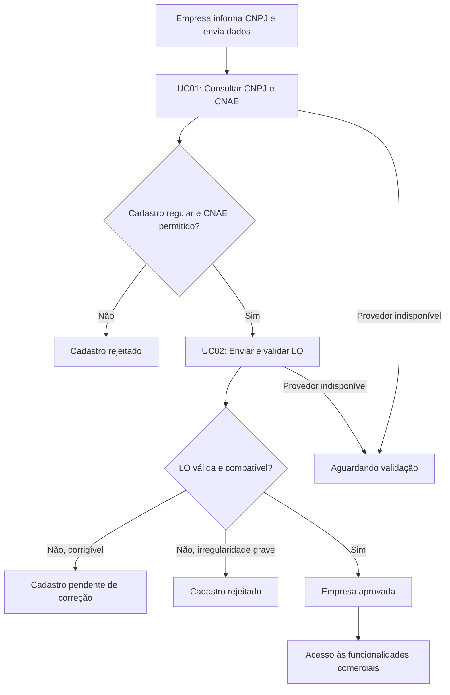
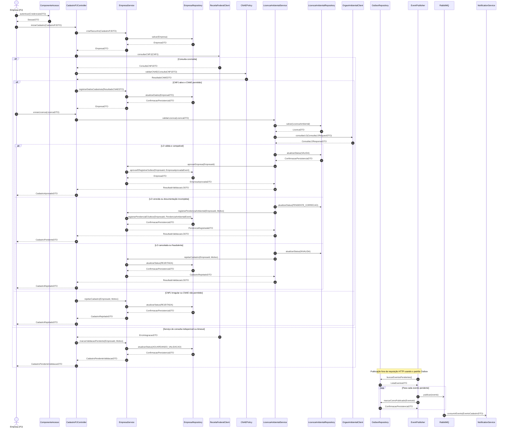
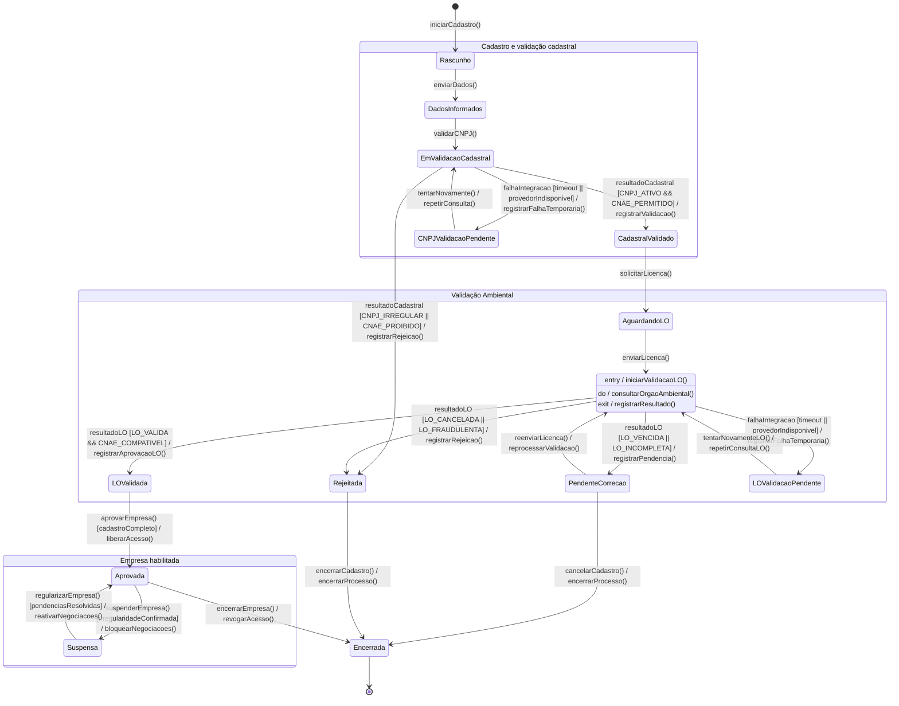

# APS3 — Marketplace B2B de Sobras
# Aluno: Yuji Kanenobu
## Funcionalidade: Cadastro de Pessoa Jurídica e Validação da Licença Ambiental

**Componente:** Acesso  
**Entidades:** `Empresa` e `LicencaAmbiental`  
**Casos de uso:**
- **UC01:** Cadastro da empresa com consulta de CNPJ e CNAE.
- **UC02:** Validação da Licença Ambiental de Operação (LO).

## 1. Objetivo

Permitir que empresas realizem seu cadastro no Marketplace B2B de sobras, garantindo que os dados cadastrais estejam regulares e que a Licença Ambiental de Operação seja válida e compatível com a atividade econômica declarada.

O processo possui duas etapas principais:

1. **UC01 — Cadastro PJ:** a empresa informa seu CNPJ. O sistema consulta os dados cadastrais, verifica a situação do CNPJ e analisa o CNAE para avaliar se a atividade é permitida na plataforma.
2. **UC02 — Validação da LO:** a empresa envia sua Licença Ambiental de Operação. O sistema verifica autenticidade, validade, situação e compatibilidade com a atividade cadastrada.

A empresa somente será aprovada quando atender aos requisitos cadastrais e ambientais definidos pelo Marketplace. Se um provedor externo estiver indisponível, o cadastro permanece aguardando validação, sem aprovação automática.

## 2. Entidades principais

### Empresa (PJ)

Representa a pessoa jurídica que deseja participar do Marketplace.

Atributos sugeridos:
- `id`
- `razaoSocial`
- `nomeFantasia`
- `cnpj`
- `cnaePrincipal`
- `situacaoCadastral`
- `statusCadastro`

### LicencaAmbiental

Representa a Licença Ambiental de Operação apresentada pela empresa.

Atributos sugeridos:
- `id`
- `empresaId`
- `numeroLicenca`
- `orgaoEmissor`
- `dataEmissao`
- `dataValidade`
- `situacao`
- `documentoUrl`

> Os atributos são uma proposta inicial de domínio. A lista final deve ser ajustada conforme as exigências do órgão ambiental e as regras do projeto. A validação eletrônica depende da existência de uma API ou fonte oficial autorizada; caso contrário, deve haver análise manual.

## 3. Fluxo geral



## 4. Artefato 1 — Diagrama de Sequência

O diagrama mostra a troca cronológica de mensagens entre a Empresa, o Componente de Acesso, os serviços de domínio, os repositórios, os provedores externos e o RabbitMQ.

- Chamadas síncronas são representadas por `->>`.
- Retornos são representados por `-->>`.
- Mensagens assíncronas são representadas por `-)`.
- Fragmentos `alt/else` representam aprovação, rejeição e falha de integração.
- O fragmento `loop` representa a publicação de cada evento pendente.
- DTOs padronizam os dados trocados entre os componentes.
- Os repositórios encapsulam o acesso ao PostgreSQL; por isso, o banco não aparece como destinatário de chamadas de objeto.

**Arquivo-fonte:** [`docs/diagrams/sequencia.mmd`](docs/diagrams/sequencia.mmd)



### Contratos públicos representados no diagrama

| Participante | Operações públicas |
|---|---|
| `ComponenteAcesso` | `autenticar()` |
| `CadastroPJController` | `iniciarCadastro()`, `enviarLicenca()` |
| `EmpresaService` | `criarRascunho()`, `registrarDadosCadastrais()`, `aprovarEmpresa()`, `registrarPendenciaAmbiental()`, `rejeitarCadastro()`, `marcarValidacaoPendente()` |
| `EmpresaRepository` | `salvar()`, `atualizarDados()`, `aprovarERegistrarOutbox()`, `registrarPendenciaEOutbox()`, `atualizarStatus()` |
| `ReceitaFederalClient` | `consultarCNPJ()` |
| `CNAEPolicy` | `validarCNAE()` |
| `LicencaAmbientalService` | `validarLicenca()` |
| `LicencaAmbientalRepository` | `salvar()`, `atualizarStatus()` |
| `OrgaoAmbientalClient` | `consultarLO()` |
| `OutboxRepository` | `buscarEventosPendentes()`, `marcarComoPublicado()` |
| `EventPublisher` | processo publicador que lê a Outbox e publica eventos |
| `RabbitMQ` | recebe publicações AMQP e entrega mensagens aos consumidores |
| `NotificationService` | `consumirEvento()` |

As chamadas ao RabbitMQ representam operações do protocolo AMQP, não métodos de uma classe de domínio. Os métodos dos repositórios são contratos de persistência que encapsulam o PostgreSQL.

## 5. Artefato 2 — Diagrama de Atividades com Raias

O diagrama representa as responsabilidades da Empresa, do Componente de Acesso, dos serviços externos e da camada de persistência/mensageria.

O Fork divide o fluxo em duas tarefas independentes: consulta de CNPJ/CNAE e análise da documentação/consulta da LO. Cada ramo chega ao Join, inclusive quando ocorre uma falha temporária de integração. Depois da sincronização, o sistema verifica se as duas consultas foram concluídas e só então avalia os resultados. Os caminhos de decisão possuem condições de guarda distintas.

**Arquivo-fonte:** [`docs/diagrams/atividades.mmd`](docs/diagrams/atividades.mmd)

```mermaid
flowchart TB
    %% Raias representadas por subgraphs.
    %% FORK e JOIN são barras visuais de divisão e sincronização do fluxo paralelo.

    subgraph PJ["RAIA 1 — Empresa (PJ)"]
        A([Início]) --> B[Informar CNPJ e dados cadastrais]
        B --> C[Enviar cadastro e documento da LO]
    end

    subgraph AC["RAIA 2 — Componente de Acesso"]
        D[Receber CadastroPJDTO e LicencaDTO]
        E{Dados obrigatórios completos?}
        F[Criar Empresa com status RASCUNHO]
        G[Consolidar os resultados das consultas]
        H{As duas consultas foram concluídas?}
        I{CNPJ ativo e CNAE permitido?}
        J{Resultado da validação da LO?}
        K[Definir Empresa como APROVADA]
        L[Registrar pendência para correção da LO]
        M[Definir Empresa como REJEITADA]
        N[Marcar cadastro como AGUARDANDO_VALIDACAO]
        O[Solicitar correção dos dados]
    end

    subgraph EXT["RAIA 3 — Serviços externos"]
        FORK["━━━━━━━━ FORK ━━━━━━━━"]
        CNPJ[Consultar CNPJ e situação cadastral]
        CNAE[Validar CNAE permitido]
        CNPJF[Registrar falha temporária da consulta CNPJ]
        DOC[Verificar integridade e dados do documento]
        LO[Consultar situação da LO no provedor ambiental]
        LOF[Registrar falha temporária da consulta LO]
        JOIN["━━━━━━━━ JOIN ━━━━━━━━"]
        FORK --> CNPJ --> CNAE --> JOIN
        CNPJ -->|[Timeout / indisponibilidade]| CNPJF --> JOIN
        FORK --> DOC --> LO --> JOIN
        LO -->|[Timeout / indisponibilidade]| LOF --> JOIN
    end

    subgraph DATA["RAIA 4 — Persistência e Mensageria"]
        P0[Persistir Empresa como RASCUNHO]
        P1[Persistir Empresa aprovada e evento Outbox]
        P2[Persistir pendência e evento Outbox]
        P3[Persistir rejeição]
        P4[Persistir status aguardando validação]
        P5[Publicar evento via RabbitMQ]
        P6[Enviar notificação assíncrona]
    end

    C --> D --> E
    E -->|[Sim]| F --> P0 --> FORK
    E -->|[Não]| O
    JOIN --> G --> H
    H -->|[Não]| N --> P4
    H -->|[Sim]| I
    I -->|[Não]| M --> P3
    I -->|[Sim]| J
    J -->|[LO válida e compatível]| K --> P1 --> P5 --> P6
    J -->|[LO vencida ou incompleta]| L --> P2 --> P5
    J -->|[LO cancelada ou fraudulenta]| M
    P6 --> Z([Fim — cadastro aprovado])
    P5 --> Z2([Fim — pendência ou rejeição comunicada])
    P4 --> Z3([Fim — aguardando nova consulta])
    P3 --> Z4([Fim — cadastro rejeitado])
    O --> Z5([Fim — aguardando correção cadastral])
```

**Observação:** o Mermaid Flowchart não possui uma notação UML nativa de Activity Diagram. Por isso, as raias são representadas por `subgraph` e as barras de Fork/Join são representadas visualmente por nós de barra, com ramificações e sincronização explícitas no fluxo.

## 6. Artefato 3 — Diagrama de Transição de Estados

A máquina de estados representa o ciclo de vida da entidade `Empresa`, desde o início do cadastro até sua aprovação, suspensão, rejeição ou encerramento.

- `[*]` indica o estado inicial ou final.
- As guardas controlam as transições conforme o resultado das validações.
- `entry`, `do` e `exit` representam ações executadas durante o estado de análise da LO.
- Falhas temporárias de integração levam ao estado `AguardandoValidacao`, sem aprovar ou rejeitar automaticamente a empresa.

**Arquivo-fonte:** [`docs/diagrams/estados.mmd`](docs/diagrams/estados.mmd)



## 7. Artefato 4 — Visão Arquitetural Macro C4 (Nível 2)

A visão C4 apresenta os contêineres da solução, as tecnologias adotadas e os protocolos de comunicação.

| Contêiner | Tecnologia | Responsabilidade |
|---|---|---|
| Interface Web | React.js | Cadastro e envio de documentos. |
| Componente de Acesso / API | Node.js | Autenticação e coordenação dos casos de uso. |
| Serviço de Empresas | Node.js | Gerenciamento da entidade Empresa. |
| Serviço Ambiental | Node.js | Gerenciamento da entidade LicencaAmbiental. |
| Banco de Dados | PostgreSQL 16 | Persistência das informações e da Outbox. |
| Mensageria | RabbitMQ | Eventos e notificações assíncronas. |
| Provedor CNPJ | API REST / HTTPS | Consulta cadastral e CNAE. |
| Provedor Ambiental | API REST / HTTPS | Consulta da situação da LO. |
| Provedor de E-mail | API HTTPS | Entrega de notificações. |

O código C4 está em [`docs/architecture/workspace.dsl`](docs/architecture/workspace.dsl) e utiliza Structurizr DSL.

### Relações e protocolos

- Interface Web → Componente de Acesso: HTTPS / JSON.
- Componente de Acesso → Serviços de domínio: REST / HTTP.
- Serviços → PostgreSQL: SQL / TCP.
- Serviços → Provedores externos: HTTPS / REST.
- Serviços → RabbitMQ: AMQP 0-9-1.
- RabbitMQ → Serviço de Notificação: AMQP 0-9-1.
- Serviço de Notificação → Provedor de E-mail: HTTPS / API.

### Decisões de modelagem

O PostgreSQL é representado como um contêiner compartilhado, com separação lógica por schemas/tabelas de domínio. Em uma implementação com serviços independentes, a propriedade dos dados e as permissões de acesso devem ser definidas para evitar dependência indevida entre os serviços.

O provedor ambiental é representado como sistema externo genérico. A existência de consulta eletrônica de LO depende do órgão ambiental competente e de integração oficialmente disponível; se não houver API, a validação deverá incluir análise manual.

## 8. Artefato 5 — Registro de Decisão Arquitetural

O ADR documenta a decisão de separar as responsabilidades cadastrais e ambientais, utilizar REST para operações síncronas e RabbitMQ com Transactional Outbox para eventos assíncronos.

**Documento:** [`docs/architecture/adr-0001.md`](docs/architecture/adr-0001.md)

## 9. Como visualizar no VSCode

1. Abra a pasta `aps3-nome-sobrenome` no VSCode.
2. Instale uma extensão de pré-visualização Mermaid, como **Markdown Preview Mermaid Support**.
3. Abra `README.md`.
4. Pressione `Ctrl + Shift + V` para abrir a pré-visualização Markdown.
5. Os diagramas Mermaid inseridos no README serão renderizados na pré-visualização.

Para visualizar o C4:
1. Abra `docs/architecture/workspace.dsl`.
2. Utilize o Structurizr Lite ou a ferramenta/CLI Structurizr compatível para renderizar o workspace.

## 10. Estrutura final do projeto

```text
aps3-nome-sobrenome/
├── docs/
│   ├── architecture/
│   │   ├── workspace.dsl
│   │   └── adr-0001.md
│   └── diagrams/
│       ├── sequencia.mmd
│       ├── atividades.mmd
│       └── estados.mmd
└── README.md
```

## 11. Considerações finais

A solução integra os cinco artefatos para documentar o cadastro PJ e a validação ambiental do Marketplace B2B de sobras.

O Componente de Acesso coordena UC01 e UC02; `Empresa` e `LicencaAmbiental` representam as entidades centrais. O uso de validações explícitas, estados controlados, integração externa e mensageria busca garantir segurança, rastreabilidade e possibilidade de evolução do sistema.
